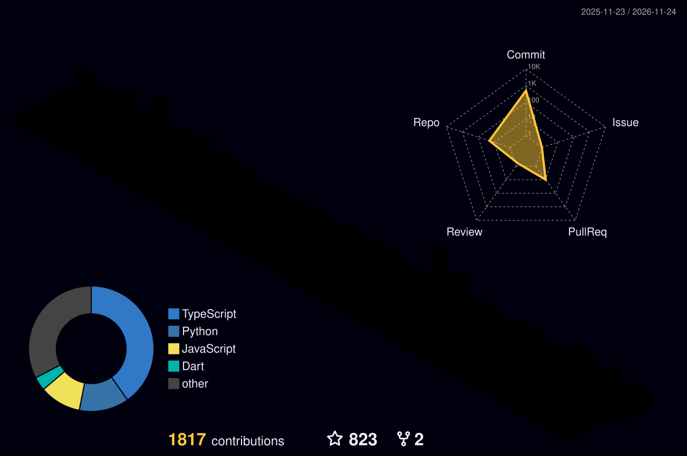

<!-- ===================== HERO SECTION ===================== -->

 

  

  

<!-- ===================== TECH BANNER ===================== -->

---

<!-- ===================== NAVIGATION ===================== -->

### 🧭 Explore My Profile

<a href="#-about-me">About Me</a> •
<a href="#-recognition--opportunities">Achievements</a> •
<a href="#-github-intelligence--analytics">GitHub Analytics</a> •
<a href="#-tech-stack--expertise">Tech Stack</a> •
<a href="#-connect-with-me">Connect</a>

---

# 💫 About Me

<table>
<tr>
<td width="50%" valign="top">

### ⚡ Professional Snapshot

**Name:** Aman Antuley

**Role:**
- Software Engineer
- AI/ML Developer
- DevOps & Cloud Enthusiast

**Location:**
- India 🇮🇳

**Specialization:**
- Full Stack Development
- Artificial Intelligence / Machine Learning
- Cloud Computing
- Android Development
- Scalable Backend Systems

**Community & Leadership:**
- GDGC Organizer
- Open Source Contributor
- Community Builder

**Achievements:**
- SIH 2025 Finalist
- Meta Global Hackathon Finalist

**Currently Exploring:**
- Distributed Systems
- Generative AI
- Kubernetes & DevOps
- Cloud Native Applications

</td>

<td width="50%" valign="top">

### 🚀 Current Mission

#### 🔭 Engineering Goals

- Building scalable AI-powered applications
- Developing real-time intelligent dashboards
- Creating cloud-native and production-ready systems
- Designing impactful digital experiences

#### 🌱 Currently Learning

- Advanced DevOps & Kubernetes
- Distributed Systems Architecture
- LLMs & AI Infrastructure
- Scalable Cloud Engineering

#### 🤝 Open To

- Software Engineering Roles
- AI/ML Opportunities
- Cloud & DevOps Internships
- Open Source Collaborations
- Innovative Startup Projects

#### 💡 Philosophy

> Building technology that creates real-world impact.

</td>
</tr>
</table>

---

## 🎯 What I Do

<table>
<tr>
<td align="center" width="25%">

### 💻

**Software Engineering**

Building scalable applications and robust software systems.

</td>

<td align="center" width="25%">

### 🤖

**Artificial Intelligence**

Developing intelligent solutions using AI and ML.

</td>

<td align="center" width="25%">

### ☁️

**Cloud & DevOps**

Automating deployments and building cloud-native infrastructure.

</td>

<td align="center" width="25%">

### 🌐

**Open Source**

Collaborating, contributing and building developer communities.

</td>
</tr>
</table>

---

---

# 🏆 Recognition & Opportunities

<table>
<tr>

<td align="center" width="33%" valign="top">

### 🌍 Meta Hackathon Finalist

Recognized for innovation, scalable engineering and impactful problem-solving in a highly competitive global hackathon environment.

</td>

<td align="center" width="33%" valign="top">

### 🧠 SIH 2025 Finalist

Built impactful real-world solutions focused on innovation, scalability and engineering excellence.

</td>

<td align="center" width="33%" valign="top">

### 💼 Open To Work

Actively exploring opportunities in:

**Full Stack • AI/ML • Cloud • Software Engineering**

</td>

</tr>
</table>

---

# ⚡ GitHub Intelligence & Analytics

<table>
<tr>

<td align="center" width="50%">

</td>

<td align="center" width="50%">

</td>

</tr>

<tr>

<td align="center" width="50%">

</td>

<td align="center" width="50%">

</td>

</tr>
</table>

---

# 🐍 Contribution Ecosystem

---

# 🏅 GitHub Achievements

---

# 🧵 3D Contribution Visualization

---

# 📈 Social Proof Metrics

---

# 🛠 Tech Stack & Expertise

### 💡 Technologies I Work With

*Building across software engineering, AI, cloud infrastructure and modern application development.*

---

## 🎨 Frontend Development

**Technologies:** HTML • CSS • JavaScript • TypeScript • React • Next.js • Redux • Bootstrap • Tailwind CSS • Material UI • Figma

---

## ⚙️ Backend Development

**Technologies:** Node.js • Express.js • Flask • FastAPI • Django • PHP

---

## 📱 Mobile Development

**Technologies:** Kotlin • Android Studio • Flutter • Dart

---

## 🤖 Artificial Intelligence / Machine Learning

**Technologies:** Python • TensorFlow • PyTorch • Scikit-learn • Anaconda

---

## 📊 Data Science & Analytics

**Technologies:** MATLAB • Data Analysis • Machine Learning • Data Visualization

---

## 🗄 Databases

**Technologies:** MySQL • MongoDB • PostgreSQL • SQLite • Firebase

---

## ☁️ Cloud & DevOps

**Technologies:** AWS • Google Cloud • Azure • Docker • Kubernetes • Linux • Git • GitHub • GitLab

---

## 🧰 Tools & IDEs

**Tools:** VS Code • PyCharm • IntelliJ IDEA • Android Studio • Postman • Notion • GitHub Actions

---

# ✍️ Daily Inspiration

---

# 🌐 Connect With Me

### 🤝 Let's Build Something Amazing Together

&nbsp;&nbsp;

&nbsp;&nbsp;

&nbsp;&nbsp;

&nbsp;&nbsp;

&nbsp;&nbsp;

  

---

<!-- ===================== FOOTER ===================== -->

### 💙 Thanks for visiting my profile!

*Let's innovate, collaborate, and build the future together.*

